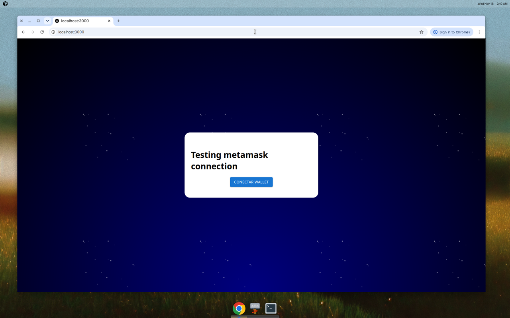

# MetaMask Wallet Integration

A Next.js web application demonstrating MetaMask wallet connection with persistent session management.



## About

This project showcases a minimal implementation of Web3 wallet integration in a Next.js application. Users can connect their MetaMask browser extension, view their Ethereum account address, and maintain their connection state across browser sessions.

## Features

- **MetaMask Connection**: Connect and disconnect your MetaMask wallet with a single click
- **Account Display**: Shows the connected Ethereum account address
- **Persistent Sessions**: Automatically reconnects to MetaMask when revisiting the app (using localStorage)
- **Animated Background**: Space-themed UI with animated stars
- **Responsive Design**: Works on desktop and mobile devices

## Tech Stack

- **Next.js** 12.0.8 - React framework for server-side rendering
- **React** 17.0.2 - UI library
- **@web3-react/core** 6.1.9 - Web3 React hooks
- **web3.js** 1.7.0 - Ethereum JavaScript API
- **Material-UI** 5.3.0 - Component library for buttons
- **CSS Modules** - Scoped styling with animations

## Prerequisites

- Node.js (v14 or higher)
- npm or yarn
- MetaMask browser extension installed

## Getting Started

### Installation

```bash
npm install
```

### Development

Run the development server:

```bash
npm run dev
```

Open [http://localhost:3000](http://localhost:3000) in your browser to see the application.

### Build

Create a production build:

```bash
npm run build
npm start
```

## Project Structure

```
.
├── config/
│   └── web3/
│       └── index.js          # Web3 connector configuration
├── pages/
│   ├── _app.js               # App wrapper with Web3ReactProvider
│   ├── index.js              # Main page with wallet connection logic
│   └── api/
│       └── hello.js          # Example API route
├── styles/
│   ├── globals.css           # Global styles
│   └── Home.module.css       # Home page styles with animations
├── docs/
│   └── screenshot.png        # App screenshot
└── package.json
```

## How It Works

1. The app initializes with `Web3ReactProvider` wrapping the entire application (`_app.js`)
2. The injected connector is configured to support Ethereum mainnet (chain ID: 1)
3. Users click "Conectar wallet" to trigger the MetaMask connection prompt
4. Once connected, the Ethereum account address is displayed
5. Connection state is saved to `localStorage` for persistence
6. On subsequent visits, the app automatically attempts to reconnect
7. Users can disconnect at any time, clearing the stored connection state

## Note

This is a learning project created in 2022 to explore Web3 wallet integration patterns. The dependencies may be outdated, and the code serves as a reference implementation rather than a production-ready solution.

---

## Versión en español

### Acerca de

Este proyecto demuestra una implementación mínima de integración de billetera Web3 en una aplicación Next.js. Los usuarios pueden conectar su extensión de navegador MetaMask, ver su dirección de cuenta de Ethereum y mantener el estado de conexión entre sesiones del navegador.

### Características principales

- Conectar y desconectar tu billetera MetaMask
- Visualización de la dirección de cuenta Ethereum conectada
- Sesiones persistentes con reconexión automática
- Interfaz con tema espacial y estrellas animadas
- Diseño responsivo para escritorio y móvil

### Tecnologías

Next.js, React, @web3-react, web3.js, Material-UI

### Nota

Proyecto de aprendizaje creado en 2022 para explorar patrones de integración de billeteras Web3.
